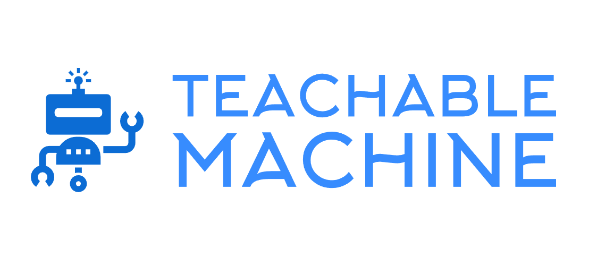

# Teachable Machine { .tm-title }

<div class="tm-hero" markdown>



**Run image models trained with Google's Teachable Machine in a few lines of Python.**
Load the exported Keras model and its labels, then classify images.

[Get started](getting-started/quickstart.md){ .md-button .md-button--primary }
[Browse examples](examples/index.md){ .md-button }

</div>

```bash
pip install teachable-machine
```

```python
from teachable_machine import TeachableMachine

model = TeachableMachine(model_path="keras_model.h5", labels_file_path="labels.txt")
result = model.classify_image("photo.jpg")

print(result["class_name"], result["class_confidence"])
```

## From idea to code

<div class="grid cards" markdown>

-   :material-school:{ .lg } **[1. Train](getting-started/export-model.md)**

    ---

    Train an image model in [Teachable Machine](https://teachablemachine.withgoogle.com/), with no coding.

-   :material-download:{ .lg } **[2. Export](getting-started/export-model.md)**

    ---

    Download it as a Keras model, `keras_model.h5`, with its `labels.txt`.

-   :material-play-circle:{ .lg } **[3. Run](getting-started/quickstart.md)**

    ---

    Give it an image and get back the class and its confidence.

</div>

## Why Teachable Machine

<div class="grid cards" markdown>

-   :material-lightning-bolt:{ .lg } **Short code**

    One line loads the model, and one call classifies an image.

-   :material-check-decagram:{ .lg } **[Works with current TensorFlow](guides/compatibility.md)**

    Exported models load on Keras 3, with no need to pin an old TensorFlow version.

-   :material-image-outline:{ .lg } **[Draws the result](guides/images-and-frames.md)**

    Get the image back with the class and confidence written on it, ready for OpenCV.

-   :material-book-open-variant:{ .lg } **[Documented results](reference/results.md)**

    Every value in the result is described, with its type.

</div>

!!! tip "Running on a Raspberry Pi or another small device?"

    Try [Teachable Machine Lite](https://meqdaddev.github.io/teachable-machine-lite/). It runs the
    TensorFlow Lite export and doesn't need the full TensorFlow.
